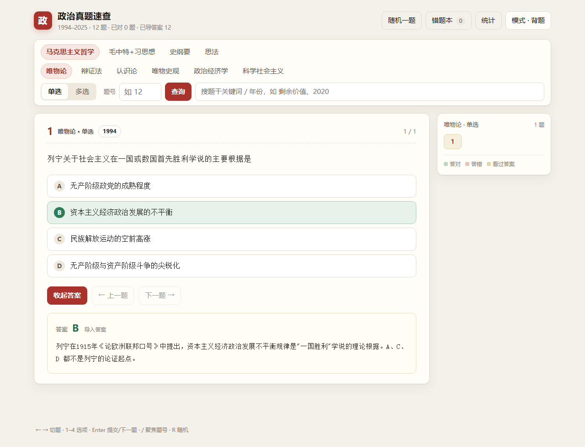

# 政治真题速查 · 考研政治刷题查询器

输入题号，立刻看到题干、答案和讲解；支持自测判分、错题本与按模块检索。纯静态网页，离线可用，放 GitHub Pages 上就能直接在手机浏览器打开。



## 它长什么样

- **按范围查题**：学科（马原 / 毛中特 / 史纲 / 思法）→ 部分（仅马原）→ 单选 / 多选 → 题号；
- **搜关键词**：题干片段、年份都能搜，例如「剩余价值」「2020」；
- **自测模式**：点选项→提交→即时判分，答错自动进错题本；
- **背题模式**：直接看答案和逐项讲解，适合二刷；
- **记录保存**：做题记录和手填答案存在浏览器 `localStorage`，统计页可导出 JSON。
- **二刷 / 重置**：顶栏「二刷·重置」可一键清做题记录（手填答案保留）、只清错题本、或全部重置。

快捷键：`/` 聚焦题号、`←/→` 切题、`1–5` 选选项、`Enter` 提交/下一题、`R` 随机、`M` 切模式。

## 快速开始

直接双击 `index.html`（或 `打开真题速查.bat`）即可，仓库里已经带 **497 题完整题库**（1994–2025），打开就能查。

## 用你自己的题库

仓库里的 497 题来自 `2026政治真题集.doc`（1994–2025 考研政治选择真题，按马原/毛中特/史纲/思法分类）。如果你想换成自己的资料，用下面这套脚本重新生成即可。

**环境**：Windows + WPS Office（用于读取 .doc）+ Python 3.9+。

```bat
:: 1. 从你的 .doc 导出段落（只读，不会改原文件）
powershell -ExecutionPolicy Bypass -File build\extract_questions.ps1 -Source "D:\你的资料\2026政治真题集.doc"

:: 2. 解析成结构化题库 data/questions.json
python build\parse.py

:: 3. 合成网页加载的 data/questions.js（此时还没有答案）
python build\build_data.py

:: 4. 体检
python build\verify.py
```

解析规则写在脚本头部：题目以 `1994-单选.（1）` 这类锚点开头，选项以 `A.` 开头，兼容选项挤在同一段、选项字母后漏点号等情况。

## 导入答案

源资料没有答案（很多「答案版」文档其实是空壳），所以答案需要单独补：

```bat
:: 生成 497 行的空白模板
python build\import_answers.py --template

:: 填好后导入（CSV / XLSX / DOCX / TXT / PDF）
python build\import_answers.py --file "路径\答案.csv"
```

或者在网页里看到「答案待导入」时直接手填，保存在本机浏览器。

模板列：`题目ID, 学科, 部分, 题型, 年份, 卷面题号, 题干摘要, 答案, 讲解`，答案写 `B` 或 `ABD`。
文本/Word/PDF 导入需要一个题号锚点 + `答案：ABD` + 解析，详见 [import/README.md](import/README.md)。

## 题号的两个坑（已处理）

1. **题号分区编号**：马原·唯物论·单选第 1 题和辩证法第 1 题是两个题，所以要先选范围；
2. **同号重复**：原始资料存在混编，同一题号可能对应两道题（例如政治经济学·多选第 4 题有 1998、2010 两版），输入时卡片顶部会列出年份候选。

## 目录

```
index.html                   界面
assets/                      app.js / styles.css / preview.png
data/questions.js            网页实际加载的题库（497 题）
build/extract_questions.ps1  WPS COM 只读导出 .doc 段落
build/parse.py               段落 → 结构化题库
build/build_data.py          题库 + 答案 → questions.js
build/import_answers.py      答案导入 / 生成模板
build/import_prompt.ps1      导入向导（给 bat 调用）
build/verify.py              体检
import/答案导入模板.csv        导入模板（本地生成，未入库）
```

## 关于答案与免责声明

- 仓库内 497 题的**答案与讲解全部由 AI 生成**，页面上标注为「AI 待校对」，其中 11 题模型自标「存疑」。它们**未经人工逐题核对**，请以你手上的权威资料为准。
- 题干来自公开的历年考研真题；整理与解析部分为本项目自行生成，与任何出版机构、培训机构无关。
- 若你是相关权利人并认为本仓库内容不妥，提交 issue，我会尽快移除对应内容。

## 数据来源

`2026政治真题集.doc`（本地整理稿）→ `build/extract_questions.ps1` 只读抽取 → `parse.py` 结构化 → `build_data.py` 合并答案。如果你想换成自己的资料，重跑这几步即可。

## License

[MIT](LICENSE)
