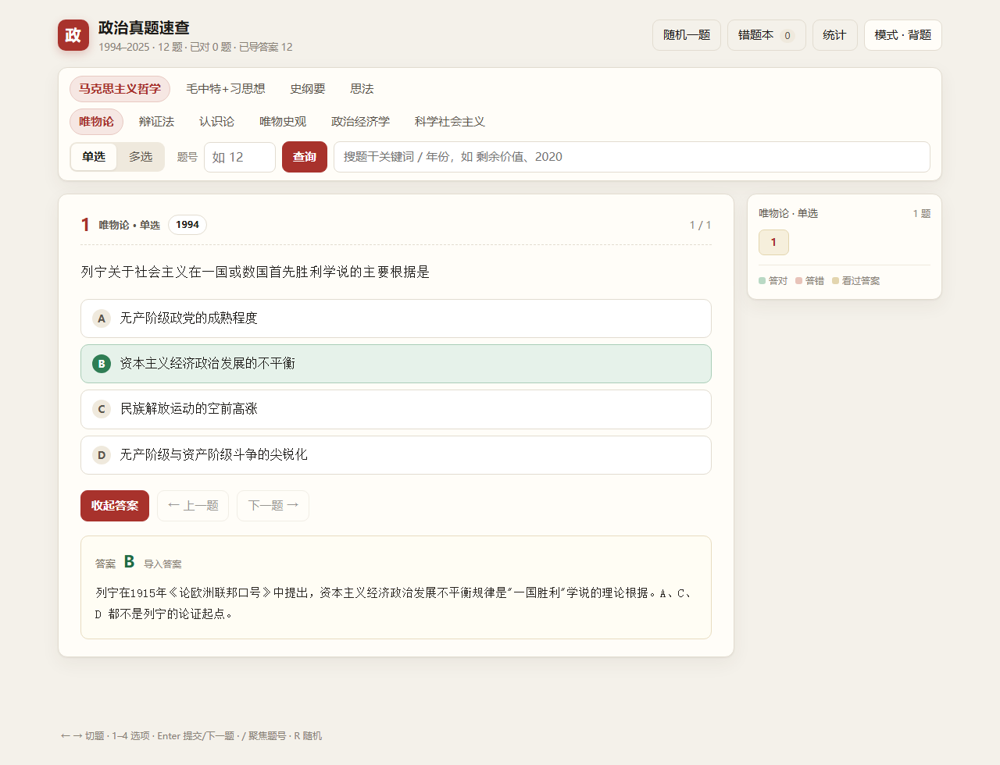

# 政治真题速查 · 考研政治刷题查询器

输入题号，立刻看到题干、答案和讲解；支持自测判分、错题本与按模块检索。纯静态网页，离线可用，放 GitHub Pages 上就能直接在手机浏览器打开。



## 它长什么样

- **按范围查题**：学科（马原 / 毛中特 / 史纲 / 思法）→ 部分（仅马原）→ 单选 / 多选 → 题号；
- **搜关键词**：题干片段、年份都能搜，例如「剩余价值」「2020」；
- **自测模式**：点选项→提交→即时判分，答对自动进入下一题，答错停在本题并展开解析，错题自动进错题本；
- **背题模式 = 知识点卡片**：只出卡片、盖住内容，点开才看到全文与关键词，看完标「熟悉 / 模糊 / 未掌握」；全屏一张一张翻，不再出选择题；
- **复习中心**：选择题错题与卡片的三档记忆分开汇总，按日期、学科筛选，一键生成当天复习清单（卡片入口统一在背题模式里）；
- **组套卷**：随机抽 16 单选 + 17 多选，按真题 1 分 / 2 分计分，交卷出成绩单并回填错题；
- **知识点手册**：100 张卡全文照录（不只是关键词）、颜色照抄手册，全屏单张翻阅，可标记记忆程度、点关联真题回跳；
- **记录保存**：做题记录、卡片记忆程度和手填答案存在浏览器 `localStorage`（`progress` 管选择题、`kbMem` 管卡片，互不干扰），统计页可导出 JSON。
- **二刷 / 重置**：顶栏「二刷·重置」可一键清做题记录（手填答案保留）、只清错题本、或全部重置。

快捷键：`/` 聚焦题号、`←/→` 切题（卡片模式里翻卡）、`1–5` 选选项、`Enter` 提交/下一题（卡片模式里展开当前卡）、`R` 随机、`M` 切模式、`K` 目录（自测时按 `K` 直接进卡片）、`V` 复习中心。

## 答题节奏：答对自动下一题

自测模式下默认开启，刷题时不用再点「下一题」：

- **答对**：横幅显示「✅ 答对了」，停留一小会儿（默认 0.9 秒）后自动翻到本题范围的下一题；
- **答错**：**留在本题**，判分横幅提示「解析见下方」，答案框展开「解析」；
- **最后一题**：不翻页，提示「已经是本题区最后一题」；
- **调停留时长**：「统计」→「做题偏好」→「停留 __ 秒 再翻页」，可选 0.4 / 0.6 / 0.9 / 1.5 / 2 / 3 秒，默认 0.9 秒；
- **关掉它**：同一处取消勾选「答对后自动进入下一题」，答对后就会停在原题，等你自己点下一题（选择会记在本机浏览器里）。

## 关键词标注：把一页纸的核心词标进题里

题目里的关键短语会和《27 考研政治一页纸 · 知识点手册》对上号，直接在题干和选项上标色：

- **红＝核心词**：答案落点，必须咬住；
- **蓝＝限定 / 陷阱词**：前提、主体、范围，「根本原因」「根本区别」这类词最容易设坑；
- **灰＝手册暂未收录**：值得记，但一页纸里还没对应条目；
- **悬停**任意标记，会浮出它对应的知识点编号与手册页码（如「知识点 001 · P05」）。

开关在「统计」→「做题偏好」→「在题目里标出关键词」，默认打开；关掉后题目恢复纯文本，选择会记在本机浏览器里。

标注数据集中放在 `data/keywords.js`（`window.ZZ_KW`），按题目 id 组织，不改题库本体：

```js
window.ZZ_KW = {
  "马克思主义哲学/唯物论/单选/17": {
    stem: [{ t: "第一个无产阶级政党", c: "core", k: "001", page: "P05" }],
    opts: { A: [{ t: "国际工人协会", c: "limit", note: "1864 年第一国际，易混" }] }
  }
};
```

已覆盖**全部 497 题**，共 **1907 处标记**（红 587 / 蓝 995 / 灰 325），平均每题 3.8 处：

| 学科 | 题数 | 标记 | 红 | 蓝 | 灰 |
|---|---|---|---|---|---|
| 马原 | 209 | 780 | 273 | 389 | 118 |
| 毛中特+习思想 | 132 | 503 | 109 | 278 | 116 |
| 史纲要 | 116 | 457 | 120 | 246 | 91 |
| 思法 | 40 | 167 | 85 | 82 | 0 |

手册知识点 001–100 已全部转录进 `%TEMP%` 下的结构化索引（P05–P35），标记里的 `k` / `page` 就是回指这些条目的。灰标 325 处＝这几类考点手册没有单独成条（史纲的具体会议年份、毛中特的部分表述、马原的经济政治发展不平衡规律等），仍然标出来，只是提示里写「手册暂未收录」。

马原 209 题内部：唯物论 21+12、辩证法 16+9、认识论 16+9、唯物史观 24+18、政治经济学 39+30、科学社会主义 4+11，全部标完。

其余题区按同一格式续标即可。`t` 必须是题干或选项里原样出现的片段，渲染时才不会错位。

> 手册 PDF 的文字层没有 ToUnicode，复制出来是乱码，条目内容是按 35 页页面图像逐页转录的。

## 背题模式：整屏知识点卡片

`模式 · 背题` 现在不再是选择题，而是**一张一张的知识点卡片**（共 100 张）；顶栏不再有单独的「知识点」按钮，卡片只在这里看：

- **一屏一张**：卡片占满内容区，只显示编号、页码、章节和标题，正文被斜纹遮罩盖住；
- **点开才看**：点遮罩（或按 `Enter`）展开全文，手册里的彩色词条自动高亮，底部列出关联真题；
- **三档记忆**：展开后点「**熟悉 / 模糊 / 未掌握**」，同一档再点一次即取消；记录写进 `zz.settings.v1` 的 `kbMem`（`知识点编号 → {level, ts}`），与选择题的错题记录完全分开；
- **翻卡**：底部「上一张 / 下一张」、键盘 `←/→`、手机上左右滑动；
- **目录（按章节 / 按页码）**：卡片底部「目录」按钮或快捷键 `K` 打开目录面板——按章节是一段一段（马原·基本知识 001–013 · P05–P06 …），按页码是一页一页（第 P05 页 · 9 张 …），点任意一张直接跳过去并展开；当前卡高亮、记过档的卡右上角有彩色圆点（绿=熟悉、黄=模糊、红=未掌握）；目录开着时 `←/→` 仍能翻卡，高亮会跟着走，`Esc` 或点空白处关闭；
- **跳题即回自测**：在卡片里点关联真题、或从搜索/错题本跳题，会自动切回自测模式并定位到那道题，回来就是卡片。

自测模式仍然只出选择题，答完（提交或直接看答案）才亮关键词；答题前只有纯题目。

## 复习中心：选择题错题 + 卡片记忆程度

顶栏「复习」按钮（快捷键 `V`）打开复习中心（这里只做汇总统计，不再放卡片入口）：

- **四张汇总卡**：选择题错题（做错且还没做对的）、卡片·熟悉、卡片·模糊、卡片·未掌握；

- **筛选**：今天 / 近 7 天 / 近 30 天 / 全部 + 指定日期 + 学科；
- **一键生成当天复习清单**：只收选择题错题（按「错题 → 未掌握 → 模糊」排序，熟记与已复习不重复出），生成后逐题翻，题卡上有「复习清单 3 / 12」进度条。

选择题的错题判定逻辑没有改动：提交答案时判对错、写 `progress`；卡片的 `kbMem` 独立存放，互不影响。`二刷·重置` 里选「全部重置」会一并清空 `progress`、`kb`、`kbMem`。

## 套卷：16 单选 + 17 多选，按真题模式计分

顶栏「组套卷」按钮一键生成一套模拟卷：

- 随机抽 16 道单选 + 17 道多选（实际就是一份真题的题量），点「开始」直接作答，题干区筛选自动收起，换成卷首信息条；
- 计分按真题：单选 1 分、多选 2 分，满分 50 分；交卷后先看总分与单选 / 多选得分，再往下逐题看错题解析；
- 交卷即回填：错题写进错题本、也进复习中心，可以直接「再来一套」或跳去复习。

## 知识点卡片：按 PDF 原样，一屏一张

卡片就是背题模式里那 100 张，按 PDF 的页序和编号顺序排，内容是手册全文照录，**不重排、不筛选**：

- **原页顺序**：手册 P05–P29 共 25 页、100 张卡，卡片顺序与 PDF 完全一致（001 是第一张、002 第二张…）；卡片顶部显示编号、印刷页码与该页章节横幅（马原 / 基本知识 / 资本主义及垄断 / 政经 / 国际…），目录里「按页码」可以一页一页看；
- **全文照排**：卡里是手册上的**全部文字**，未上色的正文也在，逐行保留手册的断行与条目；
- **颜色照抄手册**：红＝核心结论，蓝＝前提、限定与易混项；手册里带 ✅/❌ 的判断行用中性虚线下划线，不上色（免得被当成「正确」）；
- **记忆程度**：展开后点「熟悉 / 模糊 / 未掌握」，写在 `zz.settings.v1` 的 `kbMem`；另外保留一个「已复习」勾选（`kb` 字段）作为粗粒度进度；「二刷·重置 → 全部重置」会一并清空；
- **037 是图**：手册里 037「史纲整体脉络」本来就是一张时间轴图，所以这张卡不放文字，直接放矢量图（ssets/timeline-037.svg 宽屏六段横排、ssets/timeline-037-v.svg 手机单列竖排，用 <picture> 自动切换），缩放不糊、手机上字号也够大；其它 99 张卡保持文字照录。

- **颜色对应手册**：卡片正文只给手册里上色的词上色，颜色跟手册一致——红=核心结论（答案落点）、橙=强调补充（举例 / 助记锚点）、蓝=前提限定（主体 / 范围 / 条件）、绿=正误判断（手册 ✅ / ❌ 的那几行）。每张卡正文下面有一行图例，只列出这张卡真正出现的颜色。
- **关联真题**：每张卡下方列出挂了这条知识点的真题（来自 `data/keywords.js` 的既有标注，不改题库、不改标注），点一下回到那道题；
- **手机**：两列自动变单列，整页纵向滚动。

数据分两份：`data/manual.js`（`window.ZZ_MANUAL`，版面与正文）和 `data/handbook.js`（`window.ZZ_KB`，标题、彩色词条、页码）：

```js
window.ZZ_MANUAL = {
  pages: [{ printed: "P05", sections: ["马原", "基本知识"],
            cols: [[{ k: "001", title: "马恩第一个无产阶级政党", paras: ["马克思和恩格斯建立的第一个无产阶级政党：", "共产主义者同盟"] }],
                   [{ k: "006", title: "唯物史观和剩余价值学说", paras: ["…"] }]] }]
};
```

> 手册 PDF 的文字层没有 ToUnicode，复制出来是乱码（U+FFFD）。正文是用 Windows 内置 OCR（zh-Hans）在 300 dpi 下逐页识别、按列和「知识点 NNN」切卡片得到的，随后**25 页逐页对着页图人工精校过一遍**（700 余行重写：错字、徽标残留、断行、年份里的乱码数字）。卡片标题与彩色词条来自 `data/handbook.js`，那是逐页看图的转录结果。

## 快速开始

直接双击 `index.html`（或 `打开真题速查.bat`）即可，仓库里已经带 **497 题完整题库**（1994–2025），打开就能查。

## 用你自己的题库

仓库里的 497 题来自 `2026政治真题集.doc`（1994–2025 考研政治选择真题，按马原/毛中特/史纲/思法分类）。如果你想换成自己的资料，用下面这套脚本重新生成即可。

**环境**：Windows + WPS Office（用于读取 .doc）+ Python 3.9+。

```bat
:: 1. 从你的 .doc 导出段落（只读，不会改原文件）
powershell -ExecutionPolicy Bypass -File build\extract_questions.ps1 -Source "D:\你的资料\2026政治真题集.doc"

:: 2. 解析成结构化题库 data/questions.json
python build\parse.py

:: 3. 合成网页加载的 data/questions.js（此时还没有答案）
python build\build_data.py

:: 4. 体检
python build\verify.py
```

解析规则写在脚本头部：题目以 `1994-单选.（1）` 这类锚点开头，选项以 `A.` 开头，兼容选项挤在同一段、选项字母后漏点号等情况。

## 导入答案

源资料没有答案（很多「答案版」文档其实是空壳），所以答案需要单独补：

```bat
:: 生成 497 行的空白模板
python build\import_answers.py --template

:: 填好后导入（CSV / XLSX / DOCX / TXT / PDF）
python build\import_answers.py --file "路径\答案.csv"
```

或者在网页里看到「答案待导入」时直接手填，保存在本机浏览器。

模板列：`题目ID, 学科, 部分, 题型, 年份, 卷面题号, 题干摘要, 答案, 讲解`，答案写 `B` 或 `ABD`。
文本/Word/PDF 导入需要一个题号锚点 + `答案：ABD` + 解析，详见 [import/README.md](import/README.md)。

## 题号的两个坑（已处理）

1. **题号分区编号**：马原·唯物论·单选第 1 题和辩证法第 1 题是两个题，所以要先选范围；
2. **同号重复**：原始资料存在混编，同一题号可能对应两道题（例如政治经济学·多选第 4 题有 1998、2010 两版），输入时卡片顶部会列出年份候选。

## 目录

```
index.html                   界面
assets/                      app.js / styles.css / preview.png
data/questions.js            网页实际加载的题库（497 题）
data/keywords.js             题目关键词标注（1907 处）
data/handbook.js             知识点手册词条（100 条知识点 / 585 条彩色词句）
data/manual.js               知识点手册原页排版与全文（25 页 / 100 张卡）
build/build_data.py          题库 + 答案 → questions.js
build/import_answers.py      答案导入 / 生成模板
build/import_prompt.ps1      导入向导（给 bat 调用）
build/verify.py              体检
import/答案导入模板.csv        导入模板（本地生成，未入库）
```

## 关于答案与免责声明

- 仓库内 497 题的**答案与讲解全部由 AI 生成**，页面上标注为「AI 待校对」，其中 11 题模型自标「存疑」。它们**未经人工逐题核对**，请以你手上的权威资料为准。
- 题干来自公开的历年考研真题；整理与解析部分为本项目自行生成，与任何出版机构、培训机构无关。
- 若你是相关权利人并认为本仓库内容不妥，提交 issue，我会尽快移除对应内容。

## 数据来源

`2026政治真题集.doc`（本地整理稿）→ `build/extract_questions.ps1` 只读抽取 → `parse.py` 结构化 → `build_data.py` 合并答案。如果你想换成自己的资料，重跑这几步即可。

## License

[MIT](LICENSE)
